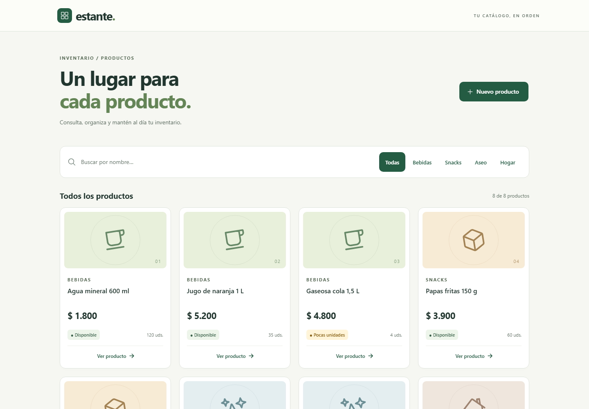

# Estante · Catálogo de productos

Parcial práctico C2 · Programación Móvil · CORHUILA 2026-B.
**Estudiante:** Pablo Esteban Santana Vidal · **GitHub:** pablo12968.

Aplicación Ionic React + TypeScript que administra productos mediante una API Express propia. Permite buscar por nombre, filtrar por categoría, crear, consultar, editar y eliminar con confirmación. Incluye ejercicio Kotlin independiente, documentación previa y pruebas automatizadas.



## Ejecutar localmente

Requisito: Node.js **22.12 o superior** y npm. Trabajar en esta carpeta, donde está package.json.

```bash
npm install
```

Copiar `.env.example` a `.env`: `Copy-Item .env.example .env` en PowerShell o `cp .env.example .env` en macOS/Linux. El valor predeterminado es `VITE_API_URL=http://localhost:3000`. `.env` está ignorado por Git; no contiene credenciales.

En la primera terminal:
```bash
npm run server
```
En otra terminal, sin cerrar la primera:
```bash
npm run dev
```

Abrir **http://localhost:5173/productos**. API: **http://localhost:3000/api/products**. Mantener libres los puertos 3000 y 5173: el CORS del starter permite localhost y 127.0.0.1 en 5173. Si se cambia VITE_API_URL, reiniciar Vite. Para detener, Ctrl+C en cada terminal.

**Persistencia:** los ocho productos semilla se copian a memoria. Al reiniciar la API se pierden los cambios, como exige el parcial. No se necesita base de datos ni cuenta de usuario.

## Rutas y uso

| Ruta | Funcionalidad |
|---|---|
| `/productos` | Búsqueda, cinco filtros, carga, vacío, sin resultados y error con reintento |
| `/productos/nuevo` | Crear con validación por campo |
| `/productos/:id` | Datos completos, editar y confirmar/cancelar eliminación |
| `/productos/:id/editar` | Cargar valores y actualizar mediante PUT |

Reglas: nombre no vacío de máximo 60 caracteres, precio finito mayor que 0, categoría Bebidas/Snacks/Aseo/Hogar y stock entero no negativo. Precio mostrado en COP. Stock 0 = Agotado; 1–4 = Pocas unidades; desde 5 = Disponible.

## Arquitectura y gobierno

```text
server/                           Express: cinco endpoints y semilla en memoria
src/features/products/
  domain/product.ts               Tipos y funciones puras de negocio
  data/                           API_URL, ApiError y cliente HTTP
  presentation/                   Páginas, ProductCard y EmptyState
  __tests__/                      Dominio, API y cliente HTTP
docs/                             Especificaciones y evidencias
kotlin/Product.kt                 Modelo nullable y descuento
e2e/                              Flujos de navegador móvil/escritorio
```

Se utilizó el [starter Ionic React oficial](https://github.com/code-corhuila/programacion-movil-2026-b-starter-react) y las plantillas del [Mobile Governance Framework](https://github.com/jesusarielgb-works/mobile-governance-framework), con las adaptaciones de alcance que permite el PDF. Las piezas resueltas del starter se conservaron: express.json, CORS, parseId, manejadores 404/500, API_URL, ApiError, request, getProducts, formatCOP, EmptyState y startTestServer.

La documentación se escribió y registró **antes del primer cambio de código**: commit `175f5f8`. El PDF enumera siete grupos documentales; al separar las tres pantallas y dos ADR resultan nueve archivos completados.

- [Feature productos](docs/features/productos.md)
- Pantallas: [lista](docs/screens/lista.md), [detalle](docs/screens/detalle.md), [crear/editar](docs/screens/formulario.md)
- Decisiones: [estado](docs/decisions/ADR-001-estado.md), [API](docs/decisions/ADR-002-consumo-api.md)
- Contratos: [cinco endpoints](docs/api/products-endpoints.md), [entidad](docs/api/product-entity.md)
- [Definition of Done](docs/definition-of-done.md)

## Contrato API

| Método | Ruta | Éxito | Errores |
|---|---|---|---|
| GET | `/api/products?search=&category=` | 200 arreglo | — |
| GET | `/api/products/:id` | 200 objeto | 400, 404 |
| POST | `/api/products` | 201 objeto | 400 |
| PUT | `/api/products/:id` | 200 objeto | 400, 404 |
| DELETE | `/api/products/:id` | 204 sin cuerpo | 400, 404 |

POST/PUT reciben `{"name":"Café","price":8500,"category":"Bebidas","stock":4}`. El servidor asigna un id incremental, que no reutiliza al eliminar. Todos los errores tienen `{ "error": "mensaje", "details": ["..."] }`; las validaciones acumulan los problemas de todos los campos.

## Pruebas y evidencias

```bash
npm test
npm run lint
npm run build
```

Resultado local verificado: **36 pruebas aprobadas**, cero pendientes, lint y compilación correctos. La compilación advierte del tamaño del paquete de Ionic, pero no presenta errores de tipos ni de build.

Para reproducir las **6 pruebas E2E**, cerrar los servidores manuales para liberar sus puertos:
```bash
npx playwright install chromium
npm run test:e2e
```
Playwright inicia/cierra ambos servidores y comprueba el CRUD real, validación, filtros, cancelación de borrado, vacío, carga, red desconectada, reintento, 404 y details del servidor en escritorio (1440×1000) y móvil (390×844). Las respuestas simuladas se usan solo para estados de error/vacío; el ciclo CRUD usa Express real. Las capturas se regeneran en docs/evidencias. GitHub Actions ejecuta las mismas comprobaciones en cada push/PR.

Ver [informe de verificación](docs/evidencias/VERIFICACION.md) y [guía de demostración](docs/GUIA-DEMOSTRACION.md).

## Kotlin

Pegar **todo** [kotlin/Product.kt](kotlin/Product.kt) en [Kotlin Playground](https://play.kotlinlang.org/) y pulsar Run. No requiere Android ni librerías adicionales. También se verificó localmente con Kotlin 2.4.21 y JDK 21:
```bash
kotlinc kotlin/Product.kt -include-runtime -d Product.jar
java -jar Product.jar
```

Salida:
```text
1. Café colombiano | Bebidas | Sin dato | Precio con 10% de descuento: $ 9000.0
2. Galletas de avena | Snacks | Agotado | Precio con 10% de descuento: $ 2430.0
3. Jabón de manos | Aseo | Pocas unidades | Precio con 10% de descuento: $ 6210.0
```
`id` usa val porque es estable; los campos editables usan var. `stock: Int?` admite null y stockLabel lo comprueba antes de comparar números. applyDiscount usa división decimal para evitar truncar el porcentaje.

## State management decision

Each page keeps its own state with React useState and loads data with useEffect. This is enough for one small feature because filters and form values do not need a global store. The API is the source of truth, and each page reloads when navigation returns to it so that saved changes appear immediately. Effect cleanup ignores stale responses after the user leaves a page. If the application grows, I would introduce a shared repository and cache and document that change in a new ADR.

## API error handling

The HTTP client throws ApiError with a null status when fetch cannot reach the server, while unsuccessful HTTP responses keep their status code and details. The form shows the server message and every detail without clearing the user's input, and read errors offer a retry action. The provided unknown-route middleware returns a 404 JSON response, and my contract test requests /api/ruta-inexistente to verify both the status and its method-and-path detail. The central four-argument error handler returns 400 for malformed JSON and a generic 500 for unexpected exceptions without exposing stack traces. The client also handles a successful DELETE as an empty 204 response instead of trying to parse JSON.

## Entrega

Rama `feature/catalogo-productos`; commits convencionales y documentación primero. Abrir PR hacia **main del propio fork**, con la descripción y checklist de [docs/PR-DESCRIPTION.md](docs/PR-DESCRIPTION.md). En Moodle se pega únicamente el enlace del PR como texto en línea; no se suben archivos.

El cierre válido es el del PDF entregado: **lunes 12 de octubre de 2026, 11:59 p. m. (Colombia)**. Las fechas antiguas del README/TODO del starter no prevalecen sobre el PDF. La entrega no exige hacer merge del PR.

**Pull Request de entrega:** https://github.com/pablo12968/programacion-movil-2026-b-starter-react/pull/1
